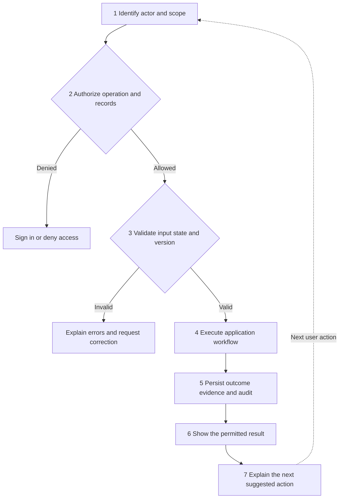

# Jjenga Code Learning Management System

Developer and coding-agent guide for the Jjenga Code LMS, from the agreed product
requirements through the initial backend and frontend setup.

**Documented baseline: 27 October 2026.** This README accompanies the initial
development scaffold and the developer handover. It gives our development partner
and Antigravity agent the context needed to continue the project consistently.

We are building one LMS for school-term programs, Saturday Coding Club and holiday
programs. It will connect practical coding and robotics, learning activities,
assessment, portfolios and long-term learner progress across all three pathways.
Teacher workload and useful growth support are core product requirements.

**Current state:** the frameworks, development tools, connectivity checks and
initial tests are in place. The LMS business workflows still require
implementation. A reserved folder does not mean its feature is complete.

Intended Windows project location: `C:\LearningManagementSystem`.
For installation, go to [Local setup](#local-setup). For agent instructions, read
[Working agreement for developers and agents](#working-agreement-for-developers-and-agents).

## Contents

- [Decisions and implementation status](#decisions-and-implementation-status)
- [Working agreement for developers and agents](#working-agreement-for-developers-and-agents)
- [Stack and architecture](#stack-and-architecture)
- [Learning pathways and learner identity](#learning-pathways-and-learner-identity)
- [Website and portal workflows](#website-and-portal-workflows)
- [Teacher workload](#teacher-workload)
- [Assessment and learner development](#assessment-and-learner-development)
- [Growth support across the system](#growth-support-across-the-system)
- [Whole-system algorithm](#whole-system-algorithm)
- [Dynamic activities and integrations](#dynamic-activities-and-integrations)
- [Nine engineering standards](#nine-engineering-standards)
- [Repository map](#repository-map)
- [Local setup](#local-setup)
- [Checks and recorded verification](#checks-and-recorded-verification)
- [Open decisions and next development sequence](#open-decisions-and-next-development-sequence)
- [Project documentation and terminology](#project-documentation-and-terminology)

## Decisions and implementation status

### Agreed direction

| Area | Direction |
| --- | --- |
| Frontend | Nuxt, Vue, Nuxt UI, Tailwind CSS and Pinia. |
| Backend | FastAPI owns internal APIs, application rules and authorization. Express was removed from the stack. |
| Database | Supabase PostgreSQL. Supabase is confirmed as our database provider. Authentication and file storage providers remain open. |
| Website | One public website leading to administrator, teacher, learner and parent or guardian portals. |
| Learning | A shared learning, assessment and progress model across all three pathways. |
| Learner history | One connected learner profile, with distinct program enrolments, attendance, activities, assessments and reports. |
| Assessment | Separate project performance, competency evidence and values observations, with a combined progress overview. |
| Interactive content | Our own configurable activity builder and player covering the discussed activity categories. |
| Growth support | Explainable, evidence-based guidance across the whole system, with appropriate human review. |
| Engineering | SOLID, clean code, useful comments, typed contracts, security, meaningful testing and maintained documentation. |

### What exists in the initial scaffold

- A runnable Nuxt application with Nuxt UI and Pinia registered.
- A development page that can check FastAPI connectivity.
- A runnable FastAPI application with health and database-readiness endpoints.
- A PostgreSQL connectivity probe using Psycopg and verified TLS.
- Consistent problem responses, request IDs and explicit local CORS origins.
- OpenAPI export and generated frontend API types.
- Backend and frontend tests, linting, type checks and dependency-boundary checks.
- Setup scripts, editor recommendations and project documentation.
- Reserved feature and portal directories for the agreed application structure.

### What still needs implementation

Authentication, sessions, record-level authorization, database tables and business
migrations, people management, program enrolment, classes, attendance, lessons,
resource uploads, the activity builder and player, assignments, submissions,
assessment, portfolios, reports, growth guidance, imports, live classes,
notifications and certificates.

No live Supabase connection or business schema was verified during scaffold
preparation. No Supabase Auth, Storage or Edge Functions integration is configured.
Authentication, private storage, durable job delivery and production hosting
remain decisions for the development team.

The status above describes the documented baseline. When continuing in an existing
checkout, inspect its current source, manifests, lockfiles and verification records;
do not overwrite later work to restore this baseline.

## Working agreement for developers and agents

Read this README and the relevant files under `docs/` before changing a feature.
Treat the product rules as acceptance criteria and inspect the current code before
planning an implementation. Direct project-owner instructions take precedence over
this README.

For each requested change:

1. Identify the workflow, actor, record scope and intended outcome.
2. Read the relevant module, API contracts, tests and architecture decisions.
3. Trace the change against the [whole-system algorithm](#whole-system-algorithm).
4. Implement it in the correct layers with focused responsibilities and explicit types.
5. Update affected contracts, migrations, tests and documentation together.
6. Run the relevant checks and review the change for access, evidence integrity and teacher workload.
7. Report what changed, which checks actually ran and any material unfinished behavior.

Preserve these boundaries:

- Keep FastAPI responsible for LMS business rules and protected resource access.
- Keep Supabase's confirmed role as PostgreSQL. Do not silently adopt additional services.
- Preserve one learner identity and program-specific records across pathways.
- Preserve historical activity versions, rubric versions, attempts and reports.
- Keep project performance, competencies and values observations separate.
- Keep recommendations explainable and advisory; preserve authorized teacher judgment.
- Preserve the root and frontend dependency roots and their lockfiles.
- Generate API types from the contract; do not manually patch generated output.
- Add files when their responsibilities are implemented; avoid empty feature simulations.
- Respect existing developer changes and keep unrelated work outside the requested change.

When a decision materially changes the architecture or product behavior, make the
tradeoff explicit and record the decision. The open decisions below are not
permission to assume providers, scoring rules or production behavior are already
agreed.

This README provides project context for the Antigravity agent. Ask the agent to
read it before making changes; it does not configure the editor or automatically
enforce the project's rules.

## Stack and architecture

One repository contains one Nuxt frontend and one FastAPI backend. The backend is
a **modular monolith**: one application divided into business modules with clear
internal boundaries.

| Component | Responsibility |
| --- | --- |
| Nuxt and Vue | Public pages, portal views, rendering, navigation, accessible UI, forms and activity interfaces. |
| Nuxt UI and Tailwind CSS | Reusable visual components and consistent styling. |
| Pinia | Appropriate shared frontend context, preferences and workflow state. |
| FastAPI | Internal API contracts, validation, authorization, use cases and coordination of database or external work. |
| Supabase PostgreSQL | Relational records, constraints, indexes and reviewed database policies and migrations. |
| Integration adapters | Implement focused application contracts for the database and selected external services. |

Nuxt's rendering runtime serves the website and portals. FastAPI remains the owner
of LMS application rules and business endpoints. Database credentials belong in
the backend environment.

### Backend dependency boundaries

Each business module reserves four layers:

| Layer | Responsibility | Dependency rule |
| --- | --- | --- |
| `domain` | Business concepts, invariants and policies. | Independent of HTTP frameworks, concrete persistence and external services. |
| `application` | Use cases, commands, queries and focused ports. | Depends on domain rules and contracts, rather than concrete adapters. |
| `api` | HTTP routing, request and response schemas, actor context and response mapping. | Calls application use cases. |
| `infrastructure` | PostgreSQL repositories and external adapters. | Implements application contracts. |

`backend/app/bootstrap.py` is the composition root that supplies concrete
implementations. The current `DatabaseProbe` protocol and `PostgresProbe` adapter
demonstrate this direction; tests can inject a compatible fake probe.

Folder names alone do not establish SOLID. Dependency direction, transaction
ownership and interface behavior must follow the same rules in the code.
Future background workers should call application use cases instead of duplicating
their business rules.

### Frontend organization

- `frontend/app/pages/` defines routes and composes views.
- `frontend/app/components/` contains shared UI.
- `frontend/app/composables/` contains shared composables.
- `frontend/app/features/` contains reusable business-facing components and composables.
- `frontend/app/stores/` contains Pinia stores; currently only preferences are implemented.
- `frontend/app/plugins/api.ts` creates the configured API client; `useApi` exposes it.
- `frontend/app/api/generated/types.ts` is generated from the exported FastAPI contract.

Feature components and composables use explicit imports. Portal pages reuse features
within the user's permitted context. The only implemented page in the baseline is
the development connectivity check.

### Dependency ownership

Root tooling and the frontend have independent npm manifests and lockfiles:

| Location | Ownership |
| --- | --- |
| `package.json` and `package-lock.json` | Shared contract-generation and browser-test tooling. |
| `frontend/package.json` and `frontend/package-lock.json` | Nuxt application dependencies and frontend checks. |
| `backend/pyproject.toml` and `backend/uv.lock` | Python application and development dependencies. |

Install both npm dependency roots. They are independent packages, not npm
workspaces. The frontend pins `esbuild` to `0.28.2` and TypeScript to `5.9.3` for
the verified tooling combination. Review the reasons before changing these pins:
[esbuild decision](docs/architecture/decisions/0001-patched-esbuild.md) and
[TypeScript decision](docs/architecture/decisions/0002-typescript-compatibility.md).

## Learning pathways and learner identity

All pathways use the same underlying learning, assessment and progress-tracking
system. Program configuration changes schedules, duration and delivery mode.

| Pathway | Records and activities to support |
| --- | --- |
| School-term programs | Enrolment, lessons, attendance, coding and robotics projects, assessment, feedback and term reports. |
| Saturday Coding Club | Weekly sessions, practical challenges, project progress, participation, skills development and values observations. |
| Holiday programs | In-person or online sessions, live classes, recordings, uploaded resources, submissions, practical assessment and values observations. |

A learner may attend school-term robotics and a holiday coding program without
acquiring separate identities or disconnected portfolios. Each enrolment still
has its own attendance, activities, assessments and reports. Online or in-person
delivery is a property separate from the pathway.

A **learner profile** and a **login account** are different concepts. We may enrol
a learner before enabling direct account access. Guardian relationships require
verification. A multi-role account may switch only between roles assigned to it;
changing a frontend selection cannot grant new permissions.

## Website and portal workflows

The public website introduces Jjenga Code and its programs and provides the entry
to login. After authentication is implemented, the server establishes the user's
assigned roles and permitted records. The selected portal, class or child controls
navigation within that scope.

| Portal | Intended work | Access boundary |
| --- | --- | --- |
| Administrator | Manage people, programs, classes, trainers, schedules, content, assessment templates, imports, reports and access. | Authorized administrative records and operations. |
| Teacher or trainer | Prepare lessons, assign work, record attendance, assess projects and values, give feedback and review reports. | Assigned classes and learners, plus authorized teaching workflows. |
| Learner | Access assigned lessons, save attempts, submit work and evidence, read feedback and track goals. | Their own permitted learning records. |
| Parent or guardian | View attendance, completed projects, released feedback, reports and development goals. | Appropriate released information for verified linked children. |

### Administrator workflow

Create programs and classes, assign trainers, enrol learners, set schedules and
assessment templates, and review operational reports. Admin management includes
individual entry and supported bulk imports, teacher access, content management,
assessment management and data export.

Supported resources may include worksheets, images, PDFs, Word documents,
PowerPoint files, videos and spreadsheets. File handling and access controls still
need implementation.

### Spreadsheet import workflow

1. Download the standard template for the supported record type.
2. Populate learner, class, attendance, assessment or other supported fields.
3. Upload the sheet and validate the file and schema.
4. Check required fields, references, duplicates and invalid values.
5. Preview valid and invalid rows, correct errors and confirm the intended changes.
6. Import valid, confirmed records according to documented transaction and update rules.
7. Show an import summary and useful row-level errors.

Define stable identifiers and explicit duplicate/update behavior. Repeated
confirmation must not create repeated records. Document whether valid rows are
committed separately or a batch is atomic, so partial success is understandable.

Uploading an Excel file as a learning resource is separate from importing records
into the database. A resource upload must never implicitly trigger an import.

### Teacher and learner workflow

The teacher selects outcomes, reuses or creates an activity, previews it and
publishes an assignment to a class or group. Learners attempt the work, save
progress and submit evidence. The teacher reviews practical work, records
appropriate judgments, gives specific feedback and identifies a next learning step.

Revisions preserve earlier attempts and the assigned activity version. Group
projects can share evidence while retaining each learner's contribution and
individual assessment where needed.

### Parent workflow

A parent selects a verified linked child and views information released for that
audience. The report should explain completed work, progress and goals in ordinary
language and offer a useful conversation prompt. Draft observations, private
teacher reflections and unpublished reports follow explicit visibility rules.

## Teacher workload

The system should help teachers teach and develop without turning every session
into an administration exercise. Record useful evidence during normal work and
reuse it in portfolios and reports.

- Provide reusable activity, rubric and feedback templates with duplication and sensible defaults.
- Support quick attendance and session recording, with deeper assessment at project milestones.
- Rotate focused observations fairly across learners; every value need not be assessed for every child in every session.
- Reuse appropriate group evidence while preserving individual contribution and judgment.
- Let learners contribute evidence where age, access and permissions make that suitable.
- Assemble report drafts from existing records and retain teacher review before release.
- Keep enrolment, imports, account administration and scheduling with administrators.
- Make guidance optional and explainable, allow authorized overrides and limit notifications to useful actions.

Bulk entry should reduce repeated work while preserving record accuracy. A shared
project photo may support several portfolios; a values observation still needs its
own relevant context and evidence. Measure assessment and reporting time during
pilots before setting workload targets.

## Assessment and learner development

Assessment goes beyond quizzes. It includes practical projects, how learners apply
technology to solve problems, competency evidence and observed values.

**Keep project performance, competencies and values separate.** The progress
overview should explain a learner's development without collapsing values into a
single character score. Provide detailed teacher reports and an appropriate
parent-friendly view using released information.

### Practical project assessment

Teachers need configurable outcomes, versioned rubrics, individual or group
assessment, written feedback and uploaded evidence such as photos, videos, code
and documents.

For an Arduino traffic-light project:

| Criterion | Example of observable evidence |
| --- | --- |
| Understanding | Explains the intended sequence and its purpose. |
| Technical skills | Connects components and uses or writes code appropriately. |
| Problem solving | Finds errors, tries solutions and explains a debugging decision. |
| Creativity | Improves the design or adds an original, useful feature. |
| Functionality | Demonstrates that the project performs its intended task. |
| Communication | Explains how the circuit and code work. |
| Collaboration | Contributes fairly and explains an individual contribution. |

Beginning, Developing, Achieving and Exceeding are example rating labels. Final
descriptors, aggregation rules and competency thresholds require agreement.
These examples are not official KICD scoring descriptors. Preserve the rubric
version attached to each historical assessment.

### Competencies

The KICD curriculum framework provides the broader foundation for linking evidence
to seven core competencies: communication and collaboration; self-efficacy;
critical thinking and problem solving; creativity and imagination; citizenship;
digital literacy; and learning to learn.

Retain the context of the evidence. A competency judgment should be supported by
what a learner demonstrated, with room for further evidence and teacher review.

### Values observations

Our assessment brief includes the following eight values. The indicators are
Jjenga Code examples for observable behavior, not official KICD scoring descriptors.

| Value | Example in a Jjenga Code activity |
| --- | --- |
| Love | Shows care and consideration toward another learner. |
| Responsibility | Handles equipment carefully and completes an assigned task. |
| Respect | Listens and considers a different idea. |
| Unity | Works cooperatively toward a shared goal. |
| Peace | Helps resolve a disagreement constructively. |
| Patriotism | Explores how technology could help a Kenyan community. |
| Social justice | Supports fair and inclusive participation. |
| Integrity | Describes their work honestly and credits others. |

Record the activity, observation, date, relevant evidence, feedback and next step.
Distinguish **not observed** from a low assessment. Clicks, speed, attendance or
completion alone do not establish a learner's values or character. Preserve
teacher judgment and the option to request more evidence.

### Portfolio and reports

Connect project instructions, rubric versions, results, evidence, demonstrated
skills and competencies, values observations, attendance, participation, teacher
comments, goals and certificates where applicable.

Reports require audience-specific visibility, review and release. Preserve
historical report versions and the source evidence used to produce them. A
combined overview can describe relationships between assessment dimensions while
keeping them distinct.

## Growth support across the system

Our growth-support design should feel like helpful everyday use. Learners receive
useful choices and feedback; teachers get manageable guidance; parents receive
constructive prompts; administrators get understandable previews and recovery.
Users should understand what is recorded and who can see it.

The design draws on self-determination theory and guidance on metacognition.
These ideas inform product behavior; the system's educational benefit still needs
evaluation in Jjenga Code's context.

| Mechanism | Behavior to implement |
| --- | --- |
| Meaningful choice | Offer suitable approaches or ways to demonstrate learning within the assigned goal. |
| Achievable challenge | Give contextual hints and progressively reduce support as independence improves. |
| Belonging and cooperation | Use shared purposes, fair participation and rotating project responsibilities. |
| Planning and reflection | Prompt a learner to plan, check an approach, explain a revision and choose a next step. |
| Retrieval and transfer | Return to earlier concepts and apply them in a different problem. |
| Specific feedback | Name a useful strategy and a concrete improvement; normalize debugging and revision. |
| Personal progress | Compare current work with the learner's own earlier evidence and goals. |

Teacher support may include a class-needs summary, an optional teaching prompt and
private reflection. Parents may receive conversation prompts about the child's
actual work. Administrators should see the affected records and a clear correction
path when an import fails.

### Guidance rules

- Begin with explicit, testable rules. A machine-learning model or LLM is not a required dependency.
- Assess evidence quality and completeness separately from learner readiness.
- Treat missing observations, interrupted attempts and access barriers as uncertainty requiring context.
- Explain why a suggestion appeared and let an authorized teacher review or override it.
- Evaluate learning, independence, transfer, fair evidence coverage and teacher workload.
- Keep users informed about data use; avoid covert psychological profiles, public character rankings and pressure to remain online.

Guidance proposes actions. It cannot grant access, publish a report, overwrite an
assessment or infer a moral trait. Authoritative records and permissions remain
with the relevant business modules. This guidance applies to the whole system,
not only to the teacher portal.

## Whole-system algorithm

Every business workflow must follow this shared pattern. Public content has a
defined public scope; protected records require the appropriate actor and object
checks. Persist changes where the operation changes state, and offer a next action
where useful to the workflow.



| Step | Required behavior |
| --- | --- |
| 1. Context | Resolve account, assigned role, program, class or child and relevant record scope. |
| 2. Authorization | Check the operation and specific records on the server. Stop if access is denied. |
| 3. Validation | Check input, references, current state, versions and retry/concurrency conditions. Explain actionable errors. |
| 4. Execution | Run the application use case and domain rules in the appropriate module. |
| 5. Persistence | Commit changes with required versions, evidence and audit records; recover or roll back on failure. |
| 6. Presentation | Return only permitted information, respecting approval and release rules. |
| 7. Next action | Explain an evidence-based suggestion, allow review and wait for the user's next action. |

For each use case, document the actor, permitted records, inputs, validation,
state transitions, transaction result, evidence and audit needs, publication rules
and recovery or next action. Failed authorization or validation must prevent the
business change.

| Workflow | Application of the pattern |
| --- | --- |
| Admin import | Verify admin scope, validate and preview rows, confirm, commit according to import rules and show a summary. |
| Teacher assessment | Verify assigned-learner access, load evidence and rubric version, save the judgment, review release and identify a next step. |
| Learner activity | Verify assignment access, load its version, preserve work and submissions, obtain checks or review, then present feedback. |
| Parent progress | Verify the guardian link, select permitted released information, explain progress and offer a useful support prompt. |

Imports and report generation that must survive process restarts need durable
delivery once that infrastructure is selected. In-process background tasks are
not a durable queue. Workers must reuse application use cases and preserve their
authorization, transaction and evidence rules.

## Dynamic activities and integrations

### Our activity builder and player

The requested scope covers all discussed activity categories. Use one configurable
editor and player with reusable blocks, templates and registries. Teachers create
content by configuring supported interactions. A genuinely new interaction needs
a corresponding editor, renderer and validation contract.

| Activity category | Authoring and playback needs |
| --- | --- |
| Lessons and resources | Instructions, images, documents, links and structured sequences. |
| Worksheets | Uploaded worksheets and structured visual or question-based tasks. |
| Quizzes | Supported question types, feedback, attempts and objective response checks. |
| Interactive video | Timed questions or reflection prompts. |
| Branching activities | Decisions, valid next steps and clear completion rules. |
| Coding activities | Code or Blockly workspaces, saved work, hints and suitable checks. |
| Practical projects | Robotics briefs, milestones, group work, evidence and configurable rubrics. |
| Reflection and goals | Planning, self-review, explanation of revisions and improvement goals. |

Reserved block families are `instruction`, `resource`, `question`, `video`,
`decision`, `code`, `project` and `reflection`. Builder and player share the
versioned block contract. Required features include drafts, preview, publication,
autosave, resume, duplication, templates and version history. Detailed schemas
remain to be designed.

Activity definitions, published versions, assignments and learner attempts are
distinct concepts. Editing a template must preserve the meaning of earlier work.
Assignments and attempts retain the version used. Branching definitions need valid
references and explicit completion behavior. Any learner code execution requires
an isolated boundary and resource limits before exposure.

### Planned tools

| Tool | Intended role | Baseline status |
| --- | --- | --- |
| Custom activity engine | Authoring, playback, attempts and assessment integration. | Folders reserved; not implemented. |
| H5P | Original reference for interactive content capabilities. | Our own engine is the working direction; H5P package compatibility is separate scope. |
| BigBlueButton | Live classes, joining and authorized recording access through its API. | Adapter folder reserved; no service configured. |
| Blockly | Browser coding workspace for supported activities. | Not installed or integrated. |
| Gotenberg | Convert approved report templates and documents into PDFs. | Adapter folder reserved; no service configured. |
| Python CSV and openpyxl | Supported imports, templates and exports. | Python is available; openpyxl and import workflows are not implemented or added as dependencies. |

Integration adapters reduce selected implementation work; our application still
owns identity, permissions, records, versions and assessment rules. Open-source
software may require paid or self-funded hosting, bandwidth, storage and
maintenance. Confirm licensing, operating limits and deployment needs when each
integration is introduced.

## Nine engineering standards

All nine points are implementation requirements. Some have scaffold support;
controls for unfinished features become acceptance criteria when those features
are introduced.

### 1. SOLID clean code and comments

| Principle | Practical rule |
| --- | --- |
| Single responsibility | Separate HTTP mapping, workflow coordination, domain rules and infrastructure access. |
| Open closed | Extend focused registries, strategies and adapters without a central conditional for every activity or provider. |
| Liskov substitution | Implementations honor their contract's behavior, error and consistency expectations. |
| Interface segregation | Expose the capabilities a consumer needs through focused contracts. |
| Dependency inversion | Depend on contracts and inject concrete implementations at the composition root. |

Use clear names, focused functions and explicit public types. Classes, protocols
and functions are all valid tools; do not create abstraction solely to fill a
folder. Comments explain intent, invariants, security assumptions and non-obvious
choices. Document public interfaces and keep comments synchronized with code.

Ruff, strict mypy and import-linter are configured for the backend. The two initial
import contracts protect domain and application boundaries; reviews still need
to assess cross-module interfaces, transaction ownership and algorithm traceability.

### 2. Database design for Supabase

Design the logical model, constraints and SQL before applying the business schema.
`supabase/migrations/` is the single schema-change history. SQL run through the
Supabase editor must also be preserved as a reviewed, reproducible migration.
Do not introduce a parallel migration history or application startup schema creation.

| Data area | Relationships and records to design |
| --- | --- |
| Identity and people | Accounts, roles, separate learner and teacher profiles and verified guardian links. |
| Programs | Pathways, programs, classes, sessions, enrolments, trainer assignments and attendance. |
| Learning | Lessons, resources, activity definitions and versions, assignments and attempts. |
| Evidence and assessment | Submissions, media references, group contributions, rubrics, project assessments, competency evidence and values observations. |
| Progress and publication | Portfolios, goals, approved feedback, report versions and certificates. |
| Operations | Import batches and errors, audit events, idempotency records and durable job records when defined. |

Use foreign keys, uniqueness and check constraints, transactions and indexes for
real query patterns. Keep media in controlled file storage with metadata and
references in PostgreSQL. Define deletion, retention, backups and restoration
before introducing real learner records.

The baseline has no business schema or SQL migrations applied. Its database
adapter only probes connectivity with `SELECT 1`. Runtime database roles and the
RLS execution strategy still need design. No ORM or separate migration framework
has been selected.

### 3. API design and durable contracts

The API contract is a maintained product interface. FastAPI schemas generate the
committed OpenAPI snapshot and frontend types. Intentional contract changes require
generation, review and compatibility checks in the same change.

| Concern | Required behavior |
| --- | --- |
| Resource naming | Clear plural resource names under `/api/v1`. |
| Request and response schemas | Consistent typed structures with documented required fields and behavior. |
| Versioning | Explicit handling of breaking changes and compatibility. |
| Pagination and filtering | Bounded page sizes, allowed filters and sort fields, deterministic ordering. |
| Authentication and authorization | Verify the actor, operation and specific records on the server. |
| Retry behavior | Define idempotency for retry-sensitive writes, scoped to the authorized caller and request intent. |
| Concurrent edits | Detect outdated versions and conflicting changes. |
| Errors | Documented problem details and useful field errors, without secrets or raw infrastructure failures. |
| Observability | Correlate requests and jobs; define appropriate logs, metrics and monitoring. |

The scaffold uses `application/problem+json` with `type`, `title`, `status`,
`detail`, `instance` and `request_id`, plus an `errors` list where relevant.
The server generates a request ID and exposes it in `X-Request-ID`.

Contract locations:

- FastAPI live schema: `/api/openapi.json`.
- Committed snapshot: `contracts/api/v1/openapi.json`.
- Generated frontend types: `frontend/app/api/generated/types.ts`.

Business endpoints, full pagination, idempotency, concurrency controls, business
audit and monitoring remain future work. Existing health routes do not establish
these capabilities.

### 4. Data structures

Choose structures that express the business rules: typed records for entities and
evidence; ordered sequences for lesson blocks; ID maps for lookup; sets for
membership; validated graphs for branching; and explicit states and transitions
for publishing, attempts, imports and reports.

Keep database, API and UI representations separate where their responsibilities
differ. Versioned JSON is suitable for dynamic activity configuration when it has
a validated schema and known block types. Critical identities, enrolments,
permissions and assessment relationships need relational integrity.

### 5. Security measures

- Enforce server-side operation and object-level access, assigned-teacher scope and verified guardian links.
- Choose secure authentication, session, recovery and applicable CSRF behavior; administrator MFA remains a proposed requirement to finalize.
- Use least-privilege database roles and test RLS for the actual connection identity. Privileged roles can bypass RLS; a FastAPI connection does not automatically inherit Supabase Auth context.
- Keep secrets in backend configuration. Use HTTPS in deployment and verify database certificates and hostnames.
- Use parameterized queries, explicit writable fields and appropriate rate, payload and time limits.
- Validate files and authored content, control downloads, sanitize rendered content and isolate any learner code execution.
- Keep sensitive records out of logs, public resources and inappropriate frontend persistence.
- Plan retention, backup restoration and dependency review.

Implemented foundations include explicit development CORS origins, secret masking,
verified-TLS probing, request IDs and redacted unexpected failures. Authenticated
sessions, record authorization, RLS, private storage, uploads, rate limits and
broader operational controls still require implementation.

The current browser client uses `credentials: 'omit'`. CORS currently permits
`GET` only. Define intended methods, headers and credential handling alongside
the future authenticated resource contracts.

### 6. Unit testing and editor support

Use **pytest** for backend rules and **Vitest** for frontend logic. Nuxt test
utilities are installed for future Nuxt-context tests. Test meaningful validation,
calculations, state transitions, import rules, guidance decisions and failure
behavior as those responsibilities are introduced. Use isolated state and
synthetic data; coverage percentages alone do not establish correctness.

Recommendations are recorded in `.vscode/extensions.json`:

| Extension | Recommendation ID | Purpose |
| --- | --- | --- |
| Python | `ms-python.python` | pytest discovery, execution and debugging. |
| Python Debugger | `ms-python.debugpy` | FastAPI debugging. |
| Vitest | `vitest.explorer` | Frontend unit-test discovery and execution. |
| Playwright | `ms-playwright.playwright` | Browser workflow testing. |
| Ruff | `charliermarsh.ruff` | Python linting and formatting. |
| ESLint | `dbaeumer.vscode-eslint` | Frontend linting. |
| Vue Official | `Vue.volar` | Vue language tooling. |
| SonarQube for IDE | `SonarSource.sonarlint-vscode` | Free local static-analysis support for code review. |

These are VS Code recommendations, not extensions installed by setup. Check
compatibility and availability in the editor you use. Architecture, authorization
and educational behavior still need review and meaningful tests; a clean static
analysis result does not prove them correct.

### 7. Validation testing

Check request schemas, real database constraints and transactions, migrations and
RLS, API contracts, full role workflows, denied access, retries, concurrent saves,
interruptions and third-party failures where relevant.

Set acceptance criteria before implementation. Include both permitted and denied
cases for each actor and relationship. Check accessibility, mobile usability and
whether the teacher workflow saves work in practice. Guidance needs checks for
missing evidence, useful explanations and authorized overrides.

### 8. System documentation

Maintain product requirements, the algorithm, architecture decisions, module
boundaries, database ERD and data dictionary, migration instructions, API contracts,
the access matrix, test strategy, setup and operating instructions, and role guides.
Add deployment, monitoring, backup and incident procedures as those
responsibilities are implemented.

Code, contracts, migrations and documentation change together. Record consequential
choices under `docs/architecture/decisions/` and keep implementation claims current.

### 9. Pinia state management

Pinia manages appropriate shared state such as display context, selected
portal/program/class/child, activity drafts, import previews and preferences.
Keep component-only state local and avoid copying every API response into global
stores. The server remains authoritative for permissions and persisted records.

Create state within the Nuxt application context for SSR isolation. Reset or
rescope sensitive caches on logout and role or child changes. Keep passwords and
privileged credentials out of stores, and make persistence an explicit decision.
The baseline registers Pinia and provides a preferences store; account and workflow
stores are still pending.

### Completion rule

Feature work must pass its required checks and review before merge. Update
contracts, migrations and documentation with the implementation, trace record
access and state changes against the algorithm, and identify material limitations.
Use the [definition of done](docs/engineering/definition-of-done.md) for review.

## Repository map

The full initial scaffold is listed in [FILE_STRUCTURE.txt](FILE_STRUCTURE.txt).
The map below explains ownership; many business areas contain reserved packages
or placeholders rather than implemented features.

| Location | Responsibility |
| --- | --- |
| `frontend/app/pages/` | Public routes and four portal route areas. |
| `frontend/app/features/` | Reusable feature UI, including activity builder, player and block families. |
| `frontend/app/stores/` | Pinia stores. |
| `frontend/app/api/` and `frontend/app/plugins/` | Problem parsing, generated API types and the API client. |
| `frontend/tests/` | Unit tests and reserved component/Nuxt test areas. |
| `backend/app/api/` | Versioned routing, dependencies, problem responses and middleware. |
| `backend/app/modules/` | Business modules with domain, application, API and infrastructure layers. |
| `backend/app/shared/` | Small shared contracts and domain foundations. |
| `backend/app/infrastructure/` | Database connectivity and reserved provider, integration and observability areas. |
| `backend/app/jobs/` | Reserved worker and job-handler area. |
| `backend/tests/` | Unit, API integration, contract and security test areas. |
| `supabase/` | SQL migrations, reference/synthetic seed area and database tests. |
| `contracts/` | OpenAPI snapshot, activity schema area and examples. |
| `docs/` | Product, architecture, engineering, API, security, testing and operational documentation. |
| `tests/` | Shared browser tests and reserved accessibility, resilience and performance areas. |
| `infrastructure/` | Reserved deployment, integration-service and monitoring configuration. |
| `scripts/` and `.vscode/` | Setup, quality checks, contract commands and editor configuration. |

### Backend module responsibilities

All modules below are reserved in `backend/app/modules/`. Their business behavior
and endpoints are still to be implemented at the baseline.

| Module | Intended responsibility |
| --- | --- |
| `identity` | Accounts, assigned roles, sessions and access concepts. |
| `people` | Learner and teacher profiles and verified guardian links. |
| `programs` | Programs, classes, schedules, sessions, enrolments and trainer assignments. |
| `content` | Lessons, resource references and content publication. |
| `activities` | Definitions, versions, assignments, attempts and response checks. |
| `attendance` | Session attendance and corrections. |
| `submissions` | Submitted work, evidence and individual group contributions. |
| `assessments` | Rubrics, competency evidence, values observations and feedback. |
| `portfolios` | Connected learning history, evidence presentation and goals. |
| `guidance` | Explainable suggestions, evidence quality, prompts and overrides. |
| `reports` | Assembly, versions, teacher review and publication. |
| `imports` | Templates, validation, preview, confirmation and summaries. |
| `media` | File metadata, validation and authorized access coordination. |
| `live_classes` | Meetings, joining permissions, recordings and integration events. |
| `notifications` | Appropriate notifications and delivery policy. |
| `certificates` | Eligibility, issuance and certificate records. |
| `audit` | Authorized audit records and sensitive-field redaction. |

## Local setup

### Prerequisites and location

Extract the original setup archive so the project root is
`C:\LearningManagementSystem` and this file is
`C:\LearningManagementSystem\README.md`. Keep existing work separately when
extracting into a location that already contains a project.

Use Node.js 24 LTS, version 24.15 or newer, and uv. The backend selects Python 3.12
through `backend/.python-version`; uv can obtain that interpreter if needed.

- [Node.js](https://nodejs.org/)
- [uv installation](https://docs.astral.sh/uv/getting-started/installation/)

Open the root folder in your editor. The archive contains source, lockfiles and
configuration; dependency directories and build output are recreated locally.
Keep both npm lockfiles and `backend/uv.lock` in version control.

The commands below use **PowerShell on Windows** and run from the project root
unless stated otherwise. `npm.cmd` and `npx.cmd` invoke the native Windows commands
directly.

### Set up the backend first

```powershell
Set-Location C:\LearningManagementSystem
uv sync --project backend --frozen

if (-not (Test-Path backend\.env)) {
    Copy-Item backend\.env.example backend\.env
}
```

Alternatively, `scripts/setup-backend.ps1` synchronizes the environment and copies
the example only when a local environment file is missing:

```powershell
.\scripts\setup-backend.ps1
```

### Set up the frontend

```powershell
npm.cmd ci
npm.cmd ci --prefix frontend
npm.cmd run postinstall --prefix frontend
npm.cmd run contracts:check
```

Alternatively:

```powershell
.\scripts\setup-frontend.ps1
```

Both npm installations are needed. The root package supplies shared tooling;
the frontend package supplies the Nuxt application. Python dependencies are
isolated in `backend/.venv`.

### Start the applications

Terminal one, from `C:\LearningManagementSystem`:

```powershell
npm.cmd run backend:dev
```

Terminal two, also from the root:

```powershell
npm.cmd run frontend:dev
```

| Address | Purpose |
| --- | --- |
| [Frontend](http://127.0.0.1:3000) | Development page with the **Check backend** button. |
| [API documentation](http://127.0.0.1:8000/api/docs) | FastAPI Swagger documentation. |
| [Live OpenAPI schema](http://127.0.0.1:8000/api/openapi.json) | Current API schema. |
| [Process liveness](http://127.0.0.1:8000/api/v1/health/live) | HTTP 200 when the process is live. |
| [Database readiness](http://127.0.0.1:8000/api/v1/health/ready) | HTTP 503 while the database is unconfigured or unavailable. |

A successful **Check backend** result confirms browser-to-API reachability.
Database readiness is separate and does not claim that LMS business workflows
are implemented.

The development backend command includes `--reload`. In the selected Uvicorn
version this uses a Windows event loop compatible with Psycopg's async driver.
The VS Code debugger uses the same mode with subprocess debugging. Revisit the
event-loop choice when designing production commands; the documented scaffold
was not verified on native Windows.

### Environment and Supabase connection

| Variable | Location | Meaning |
| --- | --- | --- |
| `LMS_ENVIRONMENT` | `backend/.env` | `development`, `test` or `production`. |
| `LMS_CORS_ORIGINS` | `backend/.env` | Explicit frontend origins as a JSON array. |
| `LMS_DATABASE_URL` | `backend/.env` | Private PostgreSQL URL; blank until configured. |
| `LMS_DATABASE_SSLROOTCERT` | `backend/.env` | Local path to the Supabase database CA certificate. |
| `NUXT_PUBLIC_API_BASE_URL` | `frontend/.env` | Public API address; defaults to `http://127.0.0.1:8000/api/v1`. |

The frontend environment file is optional for the default local API address.
Copy its example once if an override is needed:

```powershell
if (-not (Test-Path frontend\.env)) {
    Copy-Item frontend\.env.example frontend\.env
}
```

To configure database readiness:

1. Obtain the PostgreSQL connection URL from the Supabase project. Use a suitable session-pooler or direct connection for the development network.
2. URI-encode special password characters and set `LMS_DATABASE_URL` in `backend/.env`.
3. Download the project database CA certificate and set `LMS_DATABASE_SSLROOTCERT`, for example `C:/LearningManagementSystem/.certs/supabase-ca.crt`.
4. Restart the backend and check database readiness without exposing connection details.

The adapter uses `sslmode=verify-full` to verify the certificate and hostname.
The URL belongs exclusively in backend configuration. No schema changes run at
application startup, and the probe executes only `SELECT 1`.

### Common setup distinctions

| Observation | Meaning or next check |
| --- | --- |
| Frontend starts but API check fails | Start FastAPI and confirm the API base URL, port and explicit CORS origin. |
| Liveness succeeds and readiness returns 503 | The API process is live; configure and verify database connectivity separately. |
| No login or dashboards appear | Only the connectivity page exists at the baseline; portal workflows are pending. |
| Contract checks report drift | Review the intended schema change, regenerate contracts and inspect the diff. |
| Browser tests lack Chromium | Install the configured Playwright browser before running the test. |

## Checks and recorded verification

### Full local checks

From the project root:

```powershell
.\scripts\check.ps1
```

The script runs backend linting, formatting, tests, strict types and import
boundaries, then API contract checks, frontend linting, type checks, unit tests
and production build. Browser tests are separate.

Individual backend commands:

```powershell
uv run --project backend --frozen ruff check backend scripts/export_openapi.py
uv run --project backend --frozen ruff format --check backend scripts/export_openapi.py
uv run --project backend --frozen pytest backend/tests
Push-Location backend
uv run --frozen mypy app
uv run --frozen lint-imports
Pop-Location
```

Contract and frontend commands:

```powershell
npm.cmd run contracts:generate
npm.cmd run contracts:check
npm.cmd run frontend:check
npm.cmd run frontend:build
```

Run `contracts:generate` after an intentional schema change and inspect both the
OpenAPI and generated-type diffs. Use `contracts:check` to detect drift.

Browser connectivity test, after installing its browser:

```powershell
npx.cmd playwright install chromium
npm.cmd run test:e2e
```

### Recorded setup results

These are historical results from **27 October 2026**, run in a Linux development
environment with Python 3.12.14 and Node.js 24.22.1. They are not a claim that a
later checkout or the developer's Windows machine has passed. See the full
[setup verification record](docs/testing/setup-verification.md).

| Check | Recorded result |
| --- | --- |
| Backend pytest | 13 passed. |
| Backend Ruff linting and formatting | Passed. |
| Strict mypy | Passed. |
| Import boundaries | Two initial contracts kept. |
| OpenAPI snapshot and frontend API types | Matched the current contract. |
| Frontend ESLint and Nuxt types | Passed. |
| Frontend Vitest | Four passed. |
| Production Nuxt build | Passed. |
| HTTP checks | Frontend HTML and 16 assets served; API liveness, CORS and unconfigured-database 503 behavior checked. |
| npm audits | Zero reported findings in root tooling and frontend at setup. |
| Browser execution | Configured, but not run because Chromium could not be downloaded in the preparation environment. |
| Native Windows checks | Not executed; run setup and checks on the target PC. |
| Live database and migrations | No live connection verified and no business schema applied. |

Existing API tests cover health/readiness behavior, injected database outcomes,
problem responses, CORS, failure redaction, configuration handling and TLS probe
options. Frontend unit tests cover API problem parsing and fallback behavior.
These checks do not establish complete teaching workflows or production readiness.

## Open decisions and next development sequence

### Decisions still to settle

| Decision | Required detail |
| --- | --- |
| Authentication and sessions | Provider or approach, onboarding, recovery, administrator MFA, session storage and applicable CSRF protections. |
| Database model and access | ERD, identifiers, constraints, transactions, query patterns, runtime roles, RLS context and migration process. |
| Private file storage | Provider, validation, authorization, evidence retention, recording access and downloads. |
| Durable background work | Delivery, retries, deduplication, failure visibility and operation after restarts. |
| Assessment details | Rubric scales, competency evidence rules, observation cadence, report release and certificate eligibility. |
| Activity configuration | Supported interactions, schema versions, valid branching, attempt policy and execution isolation. |
| Deployment and operations | Hosting, domain, HTTPS, secrets, backup/recovery, monitoring, CI and integration capacity. |
| Privacy and rollout | Guardian verification, notices and permissions, retention, accessibility and acceptance criteria. |

A reserved provider directory does not select or implement that provider.

### Recommended sequence

1. Reproduce setup on both development machines and put the project under the team's version control.
2. Settle authentication, sessions and the access matrix before exposing learner records.
3. Design the logical database and reviewed SQL migrations alongside the first resource contracts.
4. Build one complete authorized workflow, such as program/class enrolment and attendance, including denied-access cases and real database checks.
5. Extend into content, versioned activities, assignments and submissions, followed by practical/values assessment and reviewed report publication.
6. Introduce evidence-based guidance and third-party integrations through the defined contracts, evaluating teacher workload and learner benefit during pilots.

This is a planning recommendation. Detailed milestones, ownership and deadlines
still need agreement. Completing one workflow does not reduce the full activity
builder scope or the four-portal requirements.

## Project documentation and terminology

### Read alongside this file

| Document | Purpose |
| --- | --- |
| [Backend README](backend/README.md) | Backend startup, database probing and Python checks. |
| [Frontend README](frontend/README.md) | Nuxt organization, client configuration and frontend checks. |
| [Requirements](docs/product/requirements.md) | Product scope. |
| [System algorithm](docs/product/system-algorithm.md) | Required workflow traceability. |
| [Teacher workload](docs/product/teacher-workload.md) | Workload design requirements. |
| [Assessment model](docs/product/assessment-model.md) | Projects, competency evidence and values. |
| [Growth design](docs/product/growth-design.md) | Whole-system growth support. |
| [System overview](docs/architecture/system-overview.md) | Application responsibilities and boundaries. |
| [SOLID and dependencies](docs/engineering/solid-and-dependencies.md) | Code and dependency rules. |
| [Code and comment standards](docs/engineering/code-and-comment-standards.md) | Naming, types and useful comments. |
| [Definition of done](docs/engineering/definition-of-done.md) | Completion and review criteria. |
| [API conventions](docs/api/conventions.md) | API contracts and error behavior. |
| [Access matrix](docs/security/access-matrix.md) | Actor and record boundaries to implement. |
| [Testing strategy](docs/testing/strategy.md) | Verification across layers. |
| [Setup verification](docs/testing/setup-verification.md) | Recorded checks and their limits. |
| [Database workspace](supabase/README.md) | Migration ownership and database decisions. |
| [Contracts workspace](contracts/README.md) | Shared schema and contract areas. |

### Terminology

| Term | Meaning in this project |
| --- | --- |
| Pathway | School-term, Saturday club or holiday program category. |
| Enrolment | A learner's participation in a specific program, with its own records. |
| Domain | Business concepts and rules independent of HTTP and infrastructure. |
| Use case | An application operation coordinating a business workflow. |
| Port and adapter | A focused capability contract and its concrete implementation. |
| Rubric | Versioned criteria and descriptors used to judge evidence. |
| Evidence | Contextual work or observations supporting a learning judgment. |
| Migration | A version-controlled SQL change that can reproduce the schema. |
| RLS | PostgreSQL row-level security, dependent on the actual role and execution context. |
| Idempotency | Retry behavior that avoids repeated unintended business effects. |
| OpenAPI | The machine-readable API description used for review and type generation. |

### Background references from the handover

- [KICD Basic Education Curriculum Framework 2017](https://kicd.ac.ke/wp-content/uploads/2017/10/CURRICULUMFRAMEWORK.pdf)
- [Niemiec and Ryan 2009 on autonomy competence and relatedness](https://selfdeterminationtheory.org/wp-content/uploads/2014/04/2009_NiemiecRyan_TRE.pdf)
- [EEF guidance on metacognition and self-regulated learning](https://educationendowmentfoundation.org.uk/education-evidence/guidance-reports/metacognition)
- [RFC 9457 Problem Details for HTTP APIs](https://www.rfc-editor.org/rfc/rfc9457.html)
